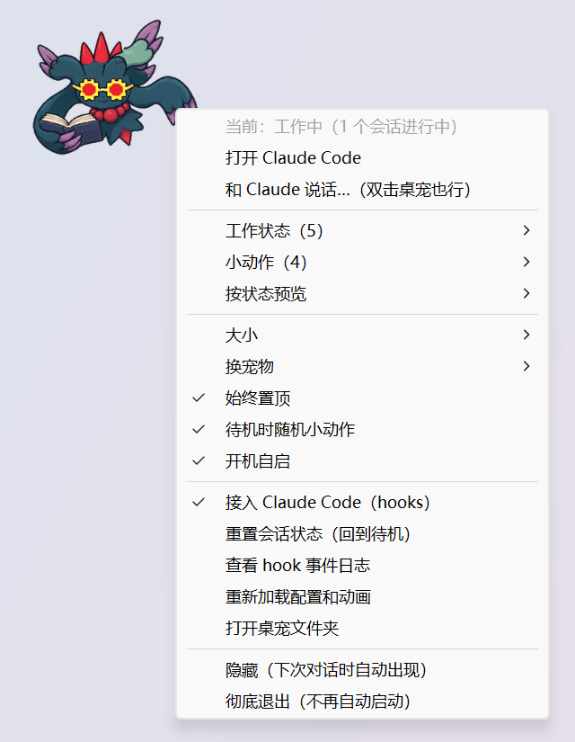

# Claude 桌宠

一个跟着 Claude Code 实时切换动作的 Windows 桌面宠物：你发消息时它在思考，Claude 调用工具时它在忙，
需要你确认权限时它会提醒你，做完了它会庆祝。还可以双击它，直接给 Claude 桌面版里的会话发消息。


单个 exe 不到 1 MB，运行时内存约 12 MB，不用安装，不用 Python 或 Node。自带三个形象（默认是像素风的鬼马史魁克，右键「换宠物」可切换）。

想换成自己的形象？在 `pets/` 下新建一个文件夹，放进 `idle.gif`、`working.gif`、`waiting.gif` 这样按状态命名的 GIF 就行，
不用写配置，也不用装 Python。详见[自己做动画包](docs/pet-format.md)。

**[⬇ 下载最新版](https://github.com/JJkun28/claude-pet/releases/latest)**（下载 `claude-pet-<版本>-win64.zip`）

## 环境需要

- Windows 10 / 11（64 位）
- Claude Code：终端里的 `claude` 和 Claude 桌面版的 Code 标签页都行
  （双击发消息的对话框只支持桌面版）

## 快速启动

1. 下载 zip，**解压**到一个固定的地方，例如 `D:\Tools\claude-pet`（别直接在压缩包里双击运行）。
2. 双击 `claude-pet.exe`，桌宠出现在屏幕右下角。它会问「要不要接入 Claude Code」，点 **「是」**。
3. **新开**一个 Claude Code 会话，随便发句话，桌宠就会跟着动了。

之后不用再管它：Claude Code 一有动静，桌宠没开也会自己出来。想开机就出现，右键勾上「开机自启」。

### 第一次打开被 Windows 拦住？

这个 exe 没有花钱买代码签名，从网上下载后 Windows 可能会提示「Windows 已保护你的电脑」。
点 **「更多信息」→「仍要运行」** 即可，只有第一次会这样。

个别杀毒软件可能会误报，因为桌宠会做这几件看起来像外挂的事：往 Claude 输入框模拟打字（对话框功能）、
写开机自启的注册表项、读取进程列表（判断 Claude 会话是否还开着）。代码全部开源，不放心可以[自己编译](docs/development.md)。

## 如何使用

- **拖动**：换位置。**单击**：它会回应你。**双击**：打开对话框，给 Claude 桌面版的会话发消息。
- **右键**：菜单。可以点播任意动作、调大小、换宠物、开机自启、接入或断开 Claude Code、隐藏或彻底退出。
- **托盘图标**（任务栏右下角，可能收在 `^` 里）：左键显示 / 隐藏桌宠，右键是同一个菜单，悬停能看到当前状态。



完整说明见 [使用说明](docs/usage.md)，各项设置见 [config.json 说明](docs/config.md)。

## 常见问题

**桌宠不动？**
- 接入以后要**新开**一个 Claude Code 会话才生效，已经开着的会话不会触发。
- 右键看「接入 Claude Code」有没有打勾。
- 右键「查看 hook 事件日志」，看看有没有收到事件。

**桌宠藏起来了，怎么找回来？**
点任务栏右下角的桌宠托盘图标（可能收在 `^` 里），或者再双击一次 `claude-pet.exe`。

**把文件夹挪了位置？**
在新位置双击打开一次 `claude-pet.exe`，它会自动把 Claude Code 里记的路径改过来。

**不想用了，怎么卸载？**
先右键 **「接入 Claude Code」把勾去掉**（断开），再「彻底退出」，然后删掉整个文件夹即可。
开着「开机自启」的话，先把它的勾去掉。除此之外，程序只在 `~/.claude` 里留下 `settings.json.claude-pet-*.bak` 备份，可以一起删掉；
如果当初放在了没有写入权限的文件夹里，设置会存在 `%APPDATA%\claude-pet`，也一起删掉。

如果已经先把文件夹删了，Claude Code 里的 hooks 还指向那个不存在的程序，可能会报 hook 错误。重新下载解压，在那个文件夹里运行一次：

```powershell
.\claude-pet.exe uninstall
```

或者手动打开 `%USERPROFILE%\.claude\settings.json`，删掉 `hooks` 里所有带 `claude-pet.exe` 的条目。

**会改动我的 Claude Code 配置吗？**
只会在 `~/.claude/settings.json` 的 `hooks` 里加桌宠自己的几条，别的配置原样保留，改之前会自动备份。
详见[接入 Claude Code 时改了什么](docs/usage.md#接入-claude-code-时改了什么)。

## 已知限制

- Windows 桌面端 Code 标签页里，`PostToolUse` 等部分 hook 可能不触发（anthropics/claude-code#97977）。少了它只会少显示「整理结果」，不影响其他状态。
- 暂不支持跟随 Codex 等其他工具的状态（Codex 的宠物美术可以[转换过来用](docs/pet-format.md#素材转换脚本)）。
- 界面目前只有中文。

## 更多文档

- [使用说明](docs/usage.md)：全部操作、对话框、状态逻辑
- [config.json 说明](docs/config.md)
- [自己做动画包](docs/pet-format.md)：放 GIF 就能用的做法、pet.json 格式、素材转换脚本
- [开发](docs/development.md)：编译、发版、代码结构、工作原理

## 许可证与素材版权

程序代码使用 [MIT 许可证](LICENSE)。动画包里的美术素材**不**适用 MIT，各自的条款如下：

- `pets/maid` 的美术素材来自 [desk-pet](https://github.com/tg111/claude-code-desk-pet) / [dsh-pet](https://github.com/PC2005-cloud/dsh-pet)，**仅限个人非商用**，分发时须保留原作者地址 <https://github.com/PC2005-cloud/dsh-pet>。
- `pets/ghost-squeak`（鬼马史魁克）是 JJkun28 制作的荒野乱斗同人像素形象，仅限非商用；角色版权归 Supercell，与 Supercell 无关联。
- `pets/zyf`（振翼发）是 JJkun28 制作的宝可梦同人像素形象，仅限非商用；角色版权归任天堂 / Creatures / GAME FREAK / The Pokémon Company，与其无关联。
